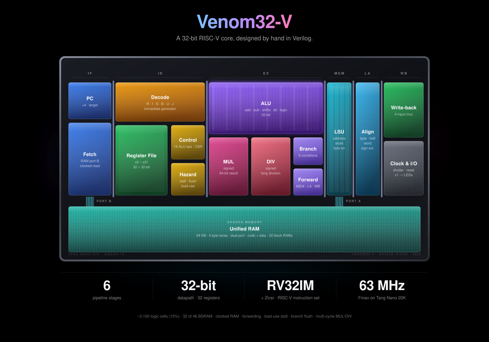
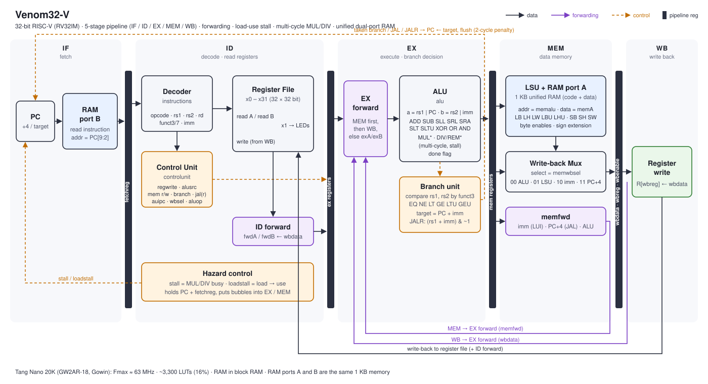

# Venom32-V

Venom32-V is a 32-bit RISC-V processor written from scratch in Verilog. It implements the RV32I base instruction set with the M extension (multiply/divide) on a 5-stage pipeline. It is a learning project: the goal is to understand how a CPU works by designing every part of it by hand. It is developed with Gowin EDA on a Sipeed Tang Nano 20K, but the CPU core itself is plain Verilog and can be used on any FPGA.



> **Branches:** Venom grew in three steps, and each one has its own branch.
> - `main`: **Venom**, the original 8-bit single-cycle CPU with its own 16-instruction set.
> - `extended`: **Venom Extended**, the same 8-bit CPU with a 5-stage pipeline.
> - `venom32-v` (this branch): **Venom32-V**, the pipelined core ported to 32-bit RISC-V.

## Overview

- **ISA:** RV32IM. All RV32I computational, load/store, branch and jump instructions, plus all eight M-extension instructions (MUL, MULH, MULHSU, MULHU, DIV, DIVU, REM, REMU). FENCE, ECALL, EBREAK and the CSR instructions are not implemented.
- 32 general-purpose 32-bit registers (x0–x31), x0 is always 0
- 5-stage pipeline (Fetch, Decode, Execute, Memory, Write-back) with forwarding, load-use stall and branch flush
- Branches and jumps are resolved in Execute by a dedicated comparator (taken branches cost 2 cycles)
- Multi-cycle multiplier and divider (signed and unsigned), which stall the pipeline until they finish
- Unified memory (von Neumann): one dual-port RAM of 1 KB holds both code and data. Port B fetches instructions, port A serves loads and stores
- Byte, halfword and word loads and stores (LB, LH, LW, LBU, LHU, SB, SH, SW) through a load-store unit
- The program is loaded into RAM from a hex file (`src/program.hex`) with `$readmemh`
- **On the Tang Nano 20K:** Fmax of about **63 MHz** (Gowin timing report), about 3,300 LUTs (16% of the chip), and the RAM is placed in block RAM (BSRAM)
- The low 8 bits of x1 are exposed as an output, and the board wrapper shows them on the LEDs

## Getting started

### Requirements

- [Gowin EDA](https://www.gowinsemi.com/en/support/download_eda/) (the Education edition is enough) to build for Tang Nano 20K
- Optional: [Icarus Verilog](https://steveicarus.github.io/iverilog/) and [GTKWave](https://gtkwave.sourceforge.net/) for simulation
- Optional: a RISC-V GNU toolchain (`riscv64-unknown-elf-gcc` / `as`) to assemble your own programs

```
git clone <repository-url>
cd venom
git checkout venom32-v
```

### Running on Tang Nano 20K

1. Open `venom.gprj` in Gowin EDA. The project is already set up for the Tang Nano 20K chip (`GW2AR-LV18QN88C8/I7`), and `src/venom.cst` contains the pin assignments.
2. Set the top module. This setting is stored in Gowin's local files, so it is not included in the repository:
   **Project → Configuration → Synthesize → Top Module/Entity** → `top`
   (the module name, not the file name `top.v`).
3. Put your program into `src/program.hex` (see [Writing programs](#writing-programs)). The repository ships with a LED counter.
4. Click **Run All** to synthesize and place & route.
5. Load the bitstream (`impl/pnr/venom.fs`) onto the board with Gowin Programmer, or with [openFPGALoader](https://github.com/trabucayre/openFPGALoader):
   ```
   openFPGALoader -b tangnano20k impl/pnr/venom.fs
   ```

**What you will see:** the six onboard LEDs show the lower 6 bits of x1 in binary. LED0 is the least significant bit. The onboard LEDs are active-low, so `top.v` inverts the value, and a lit LED means `1`. With the shipped program the LEDs count up about twice a second.

**Clock:** `top.v` divides the 27 MHz board clock down to about 260 kHz. To watch a program run instruction by instruction, slow it down to 1 Hz by changing the limit `24'd51` in `top.v` to `24'd13499999`.

**Reset:** the button on pin 88 is used as reset. Reset is synchronous and sets the PC to 0. At 1 Hz, hold the button for at least one second.

> If the CPU never seems to start, the button may work the other way around on your board and keep the CPU in reset. Change `.reset(btn)` to `.reset(~btn)` in `src/top.v`.

> If Gowin cannot find `program.hex` during synthesis, write the full path in the `$readmemh` line in `src/datamemory.v`.

### Using a different board

Only two files are specific to the Tang Nano 20K: `src/top.v` and `src/venom.cst` (plus `src/venom.sdc`, the clock constraint). Everything else is board-independent.

1. **Create a new project** in your FPGA vendor's tool for your chip and add every `.v` file in `src/` except `top.v` and the unused legacy files (see [Source files](#source-files)). Keep `program.hex` where your tool can find it.
2. **Write your own top module.** The CPU core is `datapath`:
   ```verilog
   datapath cpu(
       .clk(clk),      // board clock
       .reset(rst),    // active-high: 1 = reset
       .start(1'b0),   // unused, tie to 0
       .r1(r1)         // low 8 bits of x1
   );
   ```
   Then connect `r1` to whatever your board has: LEDs, a 7-segment display, and so on. Check the following for your board:
   - **LED polarity:** if the LEDs are active-low (0 = on), invert the value with `~` like `top.v` does. If they are active-high, don't.
   - **Reset polarity:** `datapath` expects an active-high reset. If your button reads 0 when pressed, invert it.
   - **Number of LEDs:** `top.v` uses `r1[5:0]` for 6 LEDs. Adjust the width for your board.
3. **Write a constraints file** for your board that maps your top module's ports (clock, reset button, LEDs) to the physical pins. Your board's documentation or example projects list the pin numbers.

`datapath` runs at whatever clock you give it. To watch a program step by step, add a divider like the one in `top.v`.

## Writing programs

Programs are standard RV32IM machine code. `src/program.hex` holds one 32-bit word per line, in hexadecimal. Line 0 is address `0x000`, line 1 is address `0x004`, and so on. The CPU starts executing at address 0 after reset. The same file also gives the initial contents of the data part of the RAM, since code and data share one memory.

```
00000093    // 0x000: addi x1, x0, 0
00108093    // 0x004: addi x1, x1, 1
...
```

(`$readmemh` does not accept comments after the values like this, the comments here are only for explanation. The file itself must contain only the hex words.)

Things to keep in mind:

- **Memory map:** RAM is 1 KB, addresses `0x000`–`0x3FF`. Put your code at the bottom and your data above it. Higher addresses wrap around.
- **Ending a program:** there is no HALT instruction. End with a jump to itself, `jal x0, 0` (`0000006f`).
- **Output:** whatever the program writes to x1 appears on the LEDs.
- **Alignment:** loads and stores must be naturally aligned (halfwords on even addresses, words on multiples of 4).

### Assembling with the GNU toolchain

```
riscv64-unknown-elf-as -march=rv32im -mabi=ilp32 -o prog.o prog.s
riscv64-unknown-elf-objcopy -O binary prog.o prog.bin
python3 -c "import sys,struct; d=open('prog.bin','rb').read(); d+=bytes(-len(d)%4); [print('%08x'%w) for (w,) in struct.iter_unpack('<I',d)]" > src/program.hex
```

`$readmemh` leaves the remaining RAM words uninitialized, so pad the file to 256 lines with `00000013` (NOP) if you want a clean memory.

### Example: LED counter (ships with the repository)

x1 counts up forever. Each value is written to RAM and read back with a byte load, which checks that code and data really share the same memory, then a countdown loop keeps it on the LEDs for about half a second.

```
0x00: addi x1, x0, 0         # x1 = 0
0x04: addi x1, x1, 1         # loop: x1++
0x08: sw   x1, 256(x0)       # store x1 into the data area of RAM
0x0C: lbu  x1, 256(x0)       # read it back (byte load)
0x10: lui  x2, 10            # x2 = 40960
0x14: addi x2, x2, -960      # x2 = 40000
0x18: addi x2, x2, -1        # delay loop
0x1C: bne  x2, x0, -4        #   -> 0x18
0x20: jal  x0, -28           # -> 0x04
```

Because of the byte load, x1 wraps from 255 back to 0.

## Instruction formats

Venom32-V uses the six standard RISC-V instruction formats. `rs1`, `rs2` and `rd` are always in the same place, only the immediate moves around:

```
 31        25 24    20 19    15 14  12 11          7 6      0
+------------+--------+--------+------+-------------+--------+
|   funct7   |  rs2   |  rs1   |funct3|     rd      | opcode |  R-type
+------------+--------+--------+------+-------------+--------+
|      imm[11:0]      |  rs1   |funct3|     rd      | opcode |  I-type
+------------+--------+--------+------+-------------+--------+
| imm[11:5]  |  rs2   |  rs1   |funct3|  imm[4:0]   | opcode |  S-type
+------------+--------+--------+------+-------------+--------+
|imm[12|10:5]|  rs2   |  rs1   |funct3| imm[4:1|11] | opcode |  B-type
+------------+--------+--------+------+-------------+--------+
|            imm[31:12]               |     rd      | opcode |  U-type
+-------------------------------------+-------------+--------+
|       imm[20|10:1|11|19:12]         |     rd      | opcode |  J-type
+-------------------------------------+-------------+--------+
```

`src/instructions.v` splits the word into these fields and builds the sign-extended 32-bit immediate for each format.

## Instruction set

| Group | Instructions | Notes |
|-------|--------------|-------|
| Register-register | ADD, SUB, SLL, SLT, SLTU, XOR, SRL, SRA, OR, AND | R-type |
| Register-immediate | ADDI, SLTI, SLTIU, XORI, ORI, ANDI, SLLI, SRLI, SRAI | I-type |
| Multiply/divide (M) | MUL, MULH, MULHSU, MULHU, DIV, DIVU, REM, REMU | multi-cycle, division by 0 follows the RISC-V rules |
| Loads | LB, LH, LW, LBU, LHU | through the load-store unit |
| Stores | SB, SH, SW | byte enables, only the selected bytes are written |
| Branches | BEQ, BNE, BLT, BGE, BLTU, BGEU | target = PC + imm |
| Jumps | JAL, JALR | write PC + 4 to `rd`, JALR clears bit 0 of the target |
| Upper immediate | LUI, AUIPC | AUIPC adds the immediate to its own PC |
| Not implemented | FENCE, ECALL, EBREAK, CSR* | |

## Architecture



### Pipeline

Each instruction goes through five stages, and five instructions are in flight at the same time:

```
[Fetch] ─fetchreg─▶ [Decode] ─ex regs─▶ [Execute] ─mem regs─▶ [Memory] ─wbdata/wbreg/wbenable─▶ [Write-back]
 read RAM port B     split fields,       forwarding,           load/store via LSU,               write the
 with the PC         immediate,          ALU, MUL/DIV,         write-back mux                    register file
                     control unit,       branch comparator,
                     read registers      jump target
```

- **Fetch → Decode:** `fetchreg` holds the fetched instruction and `idpc` its address.
- **Decode → Execute:** the `ex` registers hold everything Execute needs: the two operand values (`exA`, `exB`), the ALU operation (`exop`), the immediate (`exdata`), the destination register (`exout`), the source register numbers (`exopregA`, `exopregB`, used for forwarding), `funct3` (`exf3`, for the branch comparator and the LSU), the instruction's address (`expc`) and the decoded control signals (`exwen`, `exload`, `exstore`, `exalusrc`, `exbranch`, `exjal`, `exjalr`, `exauipc`, `exwbsel`).
- **Execute → Memory:** the `mem` registers: the ALU result (`memalu`, also the load/store address), the immediate (`memdata`, the LUI value), the value a store writes (`memA`), the return address (`mempc4` = PC + 4), `memf3`, the destination register (`memout`) and the control signals `memwen`, `memstore`, `memwbsel`.
- **Memory → Write-back:** `wbdata` (value), `wbreg` (destination register) and `wbenable` (write or not) hold the result for one cycle before it is written.

### Control unit

`controlunit.v` decodes the 7-bit opcode into the control signals (`regwrite`, `alusrc`, `memread`, `memwrite`, `branch`, `jal`, `jalr`, `auipc`, `wbsel`) and, from `opcode`, `funct3` and `funct7`, the 5-bit ALU operation `aluop` (18 operations). For immediate instructions `funct7` is only checked for SRAI/SRLI, because in all other I-type instructions those bits belong to the immediate.

The ALU's second operand is either `rs2` or the immediate (`alusrc`). Its first operand is `rs1`, or the instruction's own PC for AUIPC.

The value written back to the register file comes from a 4-input mux (`wbsel`):

- `00`: ALU result (arithmetic/logic instructions, AUIPC)
- `01`: data from the load-store unit (loads)
- `10`: the immediate (LUI)
- `11`: PC + 4 (JAL, JALR)

### Branches and jumps

Branches are resolved in Execute. A small comparator, separate from the ALU, checks the condition given by `funct3` on the forwarded operands:

| funct3 | Branch | Taken if |
|--------|--------|----------|
| `000` | BEQ | rs1 == rs2 |
| `001` | BNE | rs1 != rs2 |
| `100` | BLT | rs1 < rs2 (signed) |
| `101` | BGE | rs1 >= rs2 (signed) |
| `110` | BLTU | rs1 < rs2 (unsigned) |
| `111` | BGEU | rs1 >= rs2 (unsigned) |

```verilog
wire flush = (exbranch && istkn) || exjal || exjalr;
assign target = exjalr ? ((exfwdA + exdata) & ~32'd1) : expc + exdata;
```

When `flush` is 1, the PC jumps to `target`, `fetchreg` is loaded with a NOP (`addi x0, x0, 0`) and the `ex` control signals are cleared, so the two wrong instructions behind the branch are thrown away. Every taken branch or jump costs two cycles. JAL and JALR write their return address (`mempc4`) through the write-back mux.

### Forwarding (data hazards)

An instruction may need a register that an earlier instruction has not written yet. The value is forwarded from the stage that holds it:

```verilog
// Decode: an older instruction is being written back right now
assign fwdA   = (wbenable && (wbreg == opregA) && (wbreg != 0)) ? wbdata : reddataA;
// Execute: the instruction directly ahead is in Memory, the one before it in Write-back
assign memfwd = (memwbsel == 2'b10) ? memdata :
                (memwbsel == 2'b11) ? mempc4  : memalu;
assign exfwdA = (memwen && (memout == exopregA) && (memout != 0)) ? memfwd :
                ((wbenable && (wbreg == exopregA) && (wbreg != 0)) ? wbdata : exA);
```

(and the same for B). Memory has priority because it holds the newer value. `memfwd` picks the right value for LUI (immediate) and JAL/JALR (PC + 4). x0 is never forwarded, so writes to x0 are ignored as RISC-V requires. `exfwdA` and `exfwdB` feed the ALU and the branch comparator, `exfwdB` is also the value a store carries into Memory, and `exfwdA` is the base of the JALR target.

### Load-use stall

A load gets its value only in Memory, so it cannot be forwarded to the very next instruction. Decode detects this case:

```verilog
assign loadstall = exload && (exout != 0) && ((exout == opregA) || (exout == opregB));
```

When `loadstall` is 1, the PC and `fetchreg` hold, and a bubble goes into Execute. One cycle later the load is in Write-back and its value reaches the waiting instruction through forwarding.

### Multi-cycle MUL/DIV

The multiplier (`mul32bit.v`, shift-and-add) and the divider (`div32bit.v`, restoring long division) take about 32 cycles. The sign logic lives inside the modules: they work on absolute values and negate the result when needed. MULH/MULHSU/MULHU return the upper 32 bits of the 64-bit product. Division by zero returns all ones for the quotient and the dividend for the remainder, and the signed overflow case (−2³¹ / −1) follows the RISC-V rules.

When a MUL or DIV instruction reaches Execute:

1. A one-cycle `start` pulse is sent to the ALU and the `runi` flag is set.
2. The `stall` signal holds the PC, `fetchreg` and the `ex` registers, and sends bubbles into Memory.
3. When the ALU raises `done`, the result moves on, `runi` is cleared, and the PC advances.

### Memory and the load-store unit

Code and data share one RAM (`datamemory.v`, 256 × 32 bit = 1 KB) with two ports:

- **Port B** (read only) is used by Fetch: `addressB` is the PC.
- **Port A** (read and write) is used by the Memory stage through the **load-store unit** (`lsu.v`).

RISC-V addresses are byte addresses, while the RAM stores 32-bit words. The LSU splits the address: `address[9:2]` selects the word (RAM line) and `address[1:0]` the byte inside it (little-endian, byte 0 is bits `[7:0]`).

- **Loads:** the LSU reads the whole word, picks the byte or halfword, and extends it to 32 bits: with the sign bit for LB/LH, with zeros for LBU/LHU.
- **Stores:** the RAM has a 4-bit byte enable (`byen`), one bit per byte. The LSU sets it from `funct3` and the address (SW `1111`, SH `0011`/`1100`, SB one bit), and copies the byte or halfword into every lane of the write data, so the enabled lane always holds the right value.

The RAM is initialized from `src/program.hex` with `$readmemh`. Gowin places it in block RAM (8 SDPB blocks on the Tang Nano 20K).

### Timing and size

The Gowin timing report gives an Fmax of about 63 MHz on the Tang Nano 20K (the 8-bit Venom Extended reached 95 MHz). The 32-bit adders are built by hand from smaller adders as a ripple-carry chain, which is one of the longer paths. The design uses about 3,300 LUTs, 16% of the GW2AR-18.

## Source files

| File | Module | Description |
|------|--------|-------------|
| `src/top.v` | `top` | Tang Nano 20K wrapper: clock divider (~260 kHz), reset button, LEDs |
| `src/venom.cst` | | Tang Nano 20K pin assignments |
| `src/venom.sdc` | | Clock constraint (27 MHz) for the timing report |
| `src/datapath.v` | `datapath` | CPU core: connects all components, pipeline registers, forwarding, hazard detection, branch comparator and flush |
| `src/pc.v` | `pcounter` | Program counter (reset, stall, jump, PC + 4) |
| `src/instructions.v` | `instructions` | Splits the instruction into fields and builds the immediate |
| `src/controlunit.v` | `controlunit` | Decodes opcode/funct3/funct7 into control signals and the ALU operation |
| `src/registerfile.v` | `regfile` | 32 × 32-bit register file, x0 reads as 0 |
| `src/alu.v` | `alu` | 18 operations, `done` and `ispoly` (multi-cycle) flags |
| `src/adder32bit.v`, `adder8bit.v`, `adder4bit.v`, `adder2bit.v`, `fulladder.v`, `halfadder.v` | | Ripple-carry adder chain |
| `src/sub32bit.v` | `sub32bit` | Subtractor (two's complement) |
| `src/mul32bit.v` | `mul32bit` | Multi-cycle signed/unsigned multiplier |
| `src/div32bit.v` | `div32bit` | Multi-cycle signed/unsigned divider |
| `src/lsu.v` | `lsu` | Load-store unit: byte/halfword selection, sign extension, byte enables |
| `src/datamemory.v` | `datamemory` | 1 KB dual-port RAM for code and data |
| `src/mux.v` | `mux` | 4-input write-back mux |
| `src/program.hex` | | The program loaded into RAM at startup |

Left over from the 8-bit versions and not used by Venom32-V: `instructionmemory.v`, `mul8bit.v`, `div8bit.v`, `sub8bit.v`, `tb.v`.

## Simulation

With Icarus Verilog and a testbench that instantiates `datapath` (or `top`). Run it from the folder that contains `program.hex`, so `$readmemh` can find it:

```
cd src
iverilog -g2005 -o sim top.v datapath.v pc.v instructions.v controlunit.v registerfile.v alu.v \
    adder32bit.v adder8bit.v adder4bit.v adder2bit.v fulladder.v halfadder.v sub32bit.v \
    mul32bit.v div32bit.v lsu.v datamemory.v mux.v ../testbench.v
vvp sim
```

Add `$dumpfile` / `$dumpvars` to the testbench to inspect waveforms in GTKWave.

## License

See [LICENSE](LICENSE).
